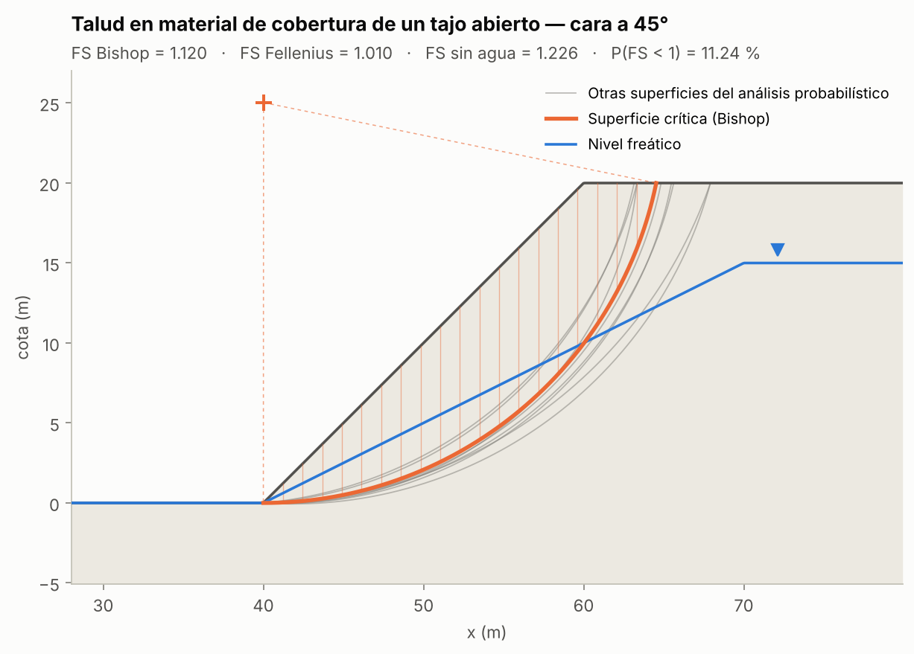
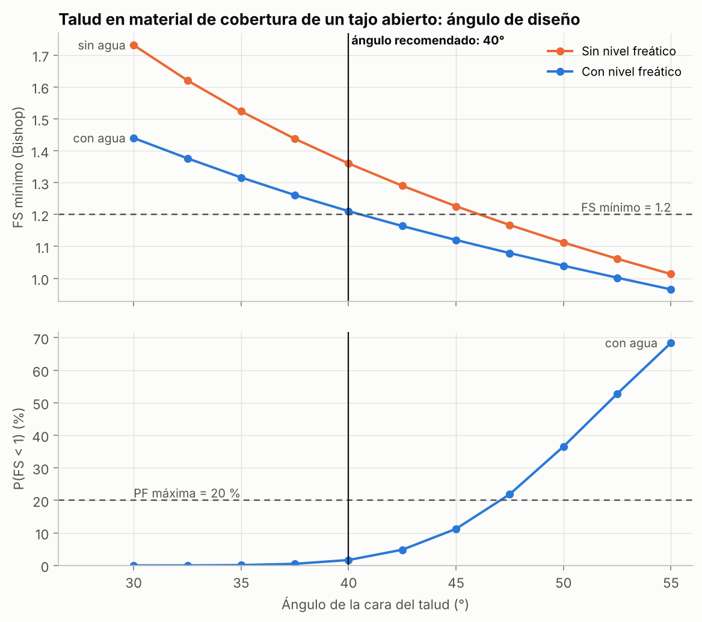
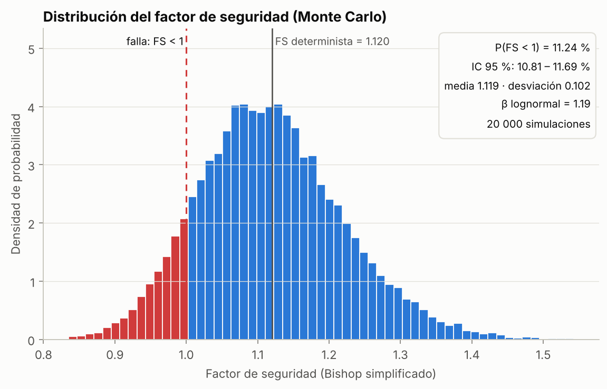

# Estabilidad de taludes: factor de seguridad y probabilidad de falla

Programa en Python que calcula el **factor de seguridad (FS)** de un talud por equilibrio límite
(Bishop simplificado, con Fellenius como control). Busca automáticamente el círculo de falla
crítico, considera el nivel freático y estima la **probabilidad de falla** P(FS < 1) por
Monte Carlo, tratando c' y φ' como variables aleatorias correlacionadas. Con esos resultados
propone el ángulo de diseño que cumple un criterio de aceptación de FS y probabilidad de falla.

Proyecto final del entrenamiento *IA para ingenieros y científicos* de DeepSkill (cohorte 01,
octubre de 2026), orientado a geomecánica y geotecnia minera. Se desarrolló con apoyo de un
agente de IA siguiendo el método del curso: requisitos → diseño → implementación → pruebas → entrega.

## Caso de estudio: talud en material de cobertura de un tajo abierto

Talud de corte de 20 m a 45° en suelo residual / roca muy meteorizada con nivel freático.
Datos: c' = 20 kPa (lognormal, COV 30 %), φ' = 30° (normal, COV 10 %), correlación
ρ(c', φ') = −0.5, γ = 19 kN/m³ y γsat = 20 kN/m³. **Son parámetros supuestos para ilustrar el
método, no resultados de ensayos.**



| Resultado (cara a 45°) | Valor |
|---|---|
| FS Bishop simplificado (con nivel freático) | **1.120** |
| FS Fellenius | 1.010 |
| FS Bishop sin nivel freático | 1.226 |
| P(FS < 1), 20 000 simulaciones | **11.24 %** (IC 95 %: 10.81–11.69 %) |
| Media y desviación del FS | 1.119 y 0.102 |
| Índice de confiabilidad β (FS lognormal) | 1.19 |

El nivel freático baja el FS de 1.226 a 1.120. Con el criterio de Read y Stacey (2009) para un
talud interrampa con consecuencia de falla media (FS ≥ 1.2 y P(FS < 1) ≤ 20 %), la cara a 45°
**no cumple por FS**, aunque su probabilidad de falla está dentro del límite.

### Ángulo de diseño

El barrido entre 30° y 55° indica que el **ángulo máximo que cumple ambos criterios es 40°**:
FS = 1.211 y P(FS < 1) = 1.67 %. Con 42.5° el FS baja a 1.164. Desde 47.5° también se supera
la probabilidad de falla admitida (21.9 %).





Los resultados completos están en [`resultados/talud_cobertura/resumen.md`](resultados/talud_cobertura/resumen.md),
y las 20 000 muestras en `muestras.csv` por si se quieren revisar en Excel.

## Validación

Cada valor se reproduce con las pruebas automáticas (`python -m unittest`). El detalle y las
fuentes están en [`docs/validacion.md`](docs/validacion.md).

| Caso de referencia | Referencia | Este programa |
|---|---|---|
| ACADS 1(a), Bishop simplificado | 1.00 (referencia del estudio); Slide2 0.987; SVSLOPE 0.989 | 0.985 |
| ACADS 1(a), Fellenius | Slide 0.947; SVSLOPE 0.945 | 0.942 |
| Corte vertical con φ = 0 (Taylor, 1937) | Hc = 3.83·c/γ | 3.831·c/γ |
| Talud infinito sin cohesión | FS = tanφ'/tanβ | error < 0.01 % |
| P(FS < 1) con φ = 0 (solución exacta) | 40.68 % | 40.75 % (error estándar 0.11 %) |
| Rosenblueth frente a Monte Carlo | media 1.123, desv. 0.102 | media 1.123, desv. 0.103 |

## Uso

Requiere Python 3.10 o superior.

```bash
python -m venv .venv
source .venv/bin/activate          # en Windows: .venv\Scripts\activate
pip install -r requirements.txt

# Análisis completo de un caso (figuras y resúmenes en resultados/<caso>/)
python -m estabilidad_taludes analizar casos/talud_cobertura.json

# Barrido del ángulo de la cara para elegir el ángulo de diseño (~1 min)
python -m estabilidad_taludes diseno casos/talud_cobertura.json --desde 30 --hasta 55 --paso 2.5

# Caso de verificación ACADS 1(a)
python -m estabilidad_taludes analizar casos/acads_1a.json

# Pruebas (25 pruebas, unos 10 s)
python -m unittest            # o: pytest
```

### Definir un caso propio

Cada caso es un archivo JSON en `casos/`. Para un talud simple basta con la altura y el ángulo;
para un perfil irregular se usan `"puntos"` (ver `casos/acads_1a.json`).

```json
{
  "nombre": "Mi talud",
  "geometria": {"altura": 20.0, "angulo": 45.0},
  "material": {"c": 20.0, "phi": 30.0, "gamma": 19.0, "gamma_sat": 20.0},
  "nivel_freatico": {"altura_en_pie": 0.0, "profundidad_bajo_corona": 5.0, "distancia_tras_corona": 10.0},
  "probabilistico": {
    "simulaciones": 20000, "semilla": 2026, "correlacion_c_phi": -0.5,
    "variables": {"c": {"distribucion": "lognormal", "cov": 0.30},
                  "phi": {"distribucion": "normal", "cov": 0.10}}
  },
  "criterios": {"fs_min": 1.2, "pf_max": 0.20, "descripcion": "Talud interrampa, consecuencia media"}
}
```

Unidades: m, kPa, kN/m³ y grados. El talud desciende hacia la izquierda (pie a la izquierda).
`nivel_freatico` y `probabilistico` son opcionales. El nivel freático también puede darse como
`{"puntos": [[x, y], ...]}`.

## Estructura

```
estabilidad_taludes/   código
  modelo.py            geometría, nivel freático y material
  metodos.py           círculos, dovelas, Fellenius y Bishop (vectorizado con numpy)
  busqueda.py          búsqueda del círculo crítico (malla + refinamiento)
  probabilistico.py    muestreo, Monte Carlo, Rosenblueth, β e intervalo de Wilson
  analisis.py          flujo completo y barrido de ángulos
  casos.py / cli.py    lectura de casos JSON y línea de comandos
  graficos.py          figuras
casos/                 casos de análisis (JSON)
tests/                 pruebas automáticas
resultados/            salidas generadas por los comandos de arriba
docs/                  requisitos, método, decisiones de diseño y validación
```

## Documentación

- [Requisitos y criterios de aceptación](docs/requisitos.md), con trazabilidad a las pruebas.
- [Método de cálculo](docs/metodo.md): fórmulas, supuestos y algoritmo de búsqueda.
- [Decisiones de diseño](docs/decisiones.md).
- [Validación](docs/validacion.md).

## Limitaciones

- Análisis bidimensional con superficies de falla **circulares** y un solo material homogéneo:
  no representa fallas controladas por estructuras (planares, en cuña o por volteo), que
  dominan en roca competente.
- Bishop simplificado no cumple el equilibrio horizontal. Spencer o Morgenstern-Price serían
  la siguiente extensión.
- Presión de poros hidrostática bajo un nivel freático; sin sismo, sobrecargas ni grietas de tracción.
- Sólo c' y φ' son aleatorias. Los parámetros del caso de estudio son supuestos: un diseño
  real exige ensayos, caracterización del macizo y revisión de un especialista.

## Referencias

- Bishop, A. W. (1955). The use of the slip circle in the stability analysis of slopes. *Géotechnique*, 5(1), 7–17.
- Fellenius, W. (1936). Calculation of the stability of earth dams. *Transactions of the 2nd Congress on Large Dams*, Washington.
- Taylor, D. W. (1937). Stability of earth slopes. *Journal of the Boston Society of Civil Engineers*, 24(3), 197–246.
- Giam, P. S. K. y Donald, I. B. (1989). *Example problems for testing soil slope stability programs*. Monash University.
- Rosenblueth, E. (1975). Point estimates for probability moments. *Proceedings of the National Academy of Sciences*, 72(10), 3812–3814.
- Read, J. y Stacey, P. (eds.) (2009). *Guidelines for Open Pit Slope Design*. CSIRO Publishing.
- Wilson, E. B. (1927). Probable inference, the law of succession, and statistical inference. *Journal of the American Statistical Association*, 22(158), 209–212.
